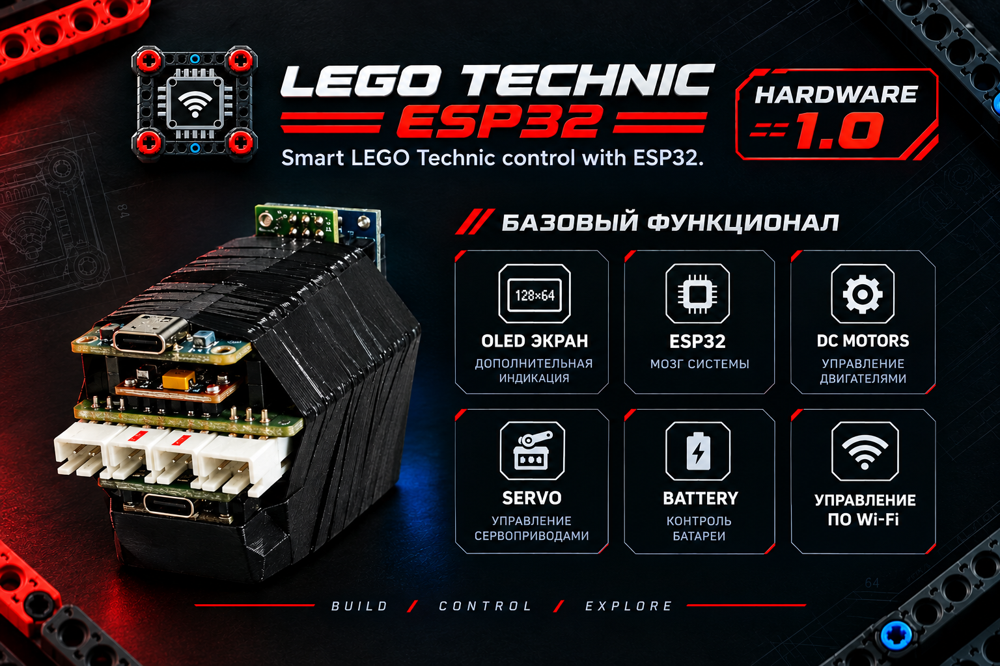

# LEGO Technic ESP32

**Оживляем LEGO Technic с помощью ESP32, открытого кода и собственного веб-интерфейса.**

Проект превращает LEGO Technic в программируемую радиоуправляемую модель. ESP32 выступает центральным контроллером, а смартфон или компьютер — пультом управления, доступным прямо в браузере.

Наша цель — создать гибкую, модульную и доступную систему управления, которую можно изучать, расширять и адаптировать под собственные модели.

## Возможности

- Управление четырьмя DC-моторами.
- Рулевое управление сервоприводом.
- Собственный веб-пульт без отдельного мобильного приложения.
- Настройки и сохранение параметров контроллера.
- Мониторинг состояния системы.
- Развитие проекта на основе открытого кода.

## Демо

Демо позволяет изучить интерфейс без подключения к физической модели.

## Документация

В технической документации собраны архитектура, устройство программных модулей, распиновка, аппаратная часть, сборка и план испытаний.

Правила SemVer и выбора метки релиза описаны в [документе о версионировании](docs/release-versioning.md).

### Чертежи, модели и сборка

- [Чертежи отдельных деталей](hardware/part-drawings/README.md)
- [Справочные размеры компонентов и LEGO Technic](hardware/reference-dimensions/README.md)
- [3D-модель корпуса и исходники KOMPAS-3D](hardware/3d-models/enclosure/README.md)
- [Иллюстрации распиновки и схем подключения](docs/assets/connection-guide/README.md)
- [Руководство по подключению и сборке](docs/connection_guide.md)
- [Планирование Hardware 2.0: распиновка, разъёмы и ревизионный список](docs/hardware_2.0/README.md)

## Первоначальная прошивка ESP32

Если у тебя новая ESP32 без прошивки, все необходимые файлы для первоначальной настройки через USB находятся в папке `firmware/bootstrap/`. Там есть стартовая прошивка с ElegantOTA, BAT-скрипт для Windows, вспомогательные скрипты и пошаговая инструкция. После первоначальной прошивки основную прошивку можно загружать через браузер с помощью ElegantOTA.

## Текущий статус
**Текущая версия прошивки: 0.13.2**

Ссылка на скачивание всегда ведёт к файлу последнего опубликованного GitHub Release. Этот бинарный файл предназначен для обновления уже настроенного контроллера через ElegantOTA, а не для первоначальной прошивки новой платы через USB.

Проект находится в стадии разработки. Перед выпуском необходимо проверить управление на реальной модели и подтвердить работу аппаратных функций.

## История изменений

