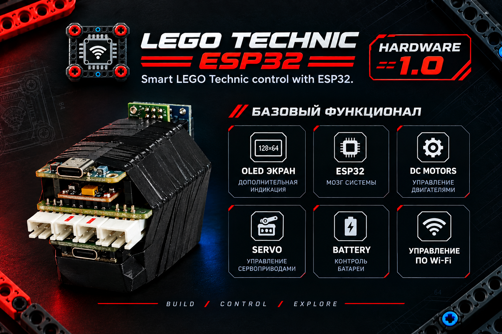

# LEGO Technic ESP32

**Оживляем LEGO Technic с помощью ESP32, открытого кода и собственного веб-интерфейса.**

Проект превращает LEGO Technic в программируемую радиоуправляемую модель. ESP32 выступает центральным контроллером, а смартфон или компьютер — пультом управления, доступным прямо в браузере.

Наша цель — создать гибкую, модульную и доступную систему управления, которую можно изучать, расширять и адаптировать под собственные модели.

## Возможности

- Управление шестью моторными каналами A–F через FeatherWing и TB6612FNG.
- Позиционное управление модифицированным LEGO PF Servo с аналоговой обратной связью.
- Рулевое управление отдельным сервоприводом.
- Собственный веб-пульт без отдельного мобильного приложения.
- Настройки и сохранение параметров контроллера.
- Мониторинг состояния системы.
- Развитие проекта на основе открытого кода.

## Демо

Демо позволяет изучить интерфейс без подключения к физической модели.

## Документация

В технической документации собраны архитектура, устройство программных модулей, распиновка, аппаратная часть, сборка и план испытаний. Для быстрого восстановления контекста между рабочими сессиями см. [передачу контекста проекта](docs/PROJECT_HANDOFF.md).

Правила SemVer и выбора метки релиза описаны в [документе о версионировании](docs/release-versioning.md).

### Чертежи, модели и сборка

- [Чертежи отдельных деталей](hardware/part-drawings/README.md)
- [Справочные размеры компонентов и LEGO Technic](hardware/reference-dimensions/README.md)
- [3D-модель корпуса и исходники KOMPAS-3D](hardware/3d-models/enclosure/README.md)
- [Иллюстрации распиновки и схем подключения](docs/assets/connection-guide/README.md)
- [Руководство по подключению и сборке](docs/connection_guide.md)
- [Планирование Hardware 2.0: распиновка, разъёмы и ревизионный список](docs/hardware_2.0/README.md)

## Первоначальная прошивка ESP32

Для новой классической ESP32 DevKit с Flash 4 МБ используй универсальную заводскую прошивку из отдельного репозитория: [ESP32 Factory](https://github.com/dsr987/esp32-factory).

Для LEGO Technic выбирай **Extended**. Эта таблица полностью совпадает с используемой проектом схемой `min_spiffs` из Arduino ESP32 Core 2.0.9. Увеличенные OTA-слоты оставляют запас под развитие встроенного графического пульта, расширение танкового режима и новые функции. Интерфейс и его ресурсы входят в приложение, поэтому проекту важнее размер OTA-слотов, а не большой SPIFFS:

- два OTA-слота по 1920 КиБ (`0x1E0000`) каждый;
- SPIFFS 128 КиБ;
- coredump 64 КиБ;
- NVS 20 КиБ для `Preferences` и OTA metadata 8 КиБ.

Порядок установки:

1. Скачай архив `esp32-factory-4mb.zip` из [GitHub Release ESP32 Factory](https://github.com/dsr987/esp32-factory/releases/tag/Release).
2. Запусти `ESP32-Auto-Flasher.bat` и выбери **Factory Reset → Extended**. Эта операция полностью стирает Flash и устанавливает загрузчик, таблицу разделов и универсальную Factory.
3. Подключись к Wi-Fi `ESP32`, пароль `12345678`.
4. Открой `http://192.168.4.1/update`. Логин и пароль ElegantOTA: `admin` / `admin`.
5. Загрузи app-only BIN основной прошивки LEGO Technic из успешной сборки GitHub Actions.

После обновления Factory заменится основной прошивкой LEGO Technic, а точка доступа станет `LegoTechnic`.

## Текущий статус
**Текущая версия прошивки: 0.14.2**

Ссылка на скачивание всегда ведёт к файлу последнего опубликованного GitHub Release. Этот бинарный файл предназначен для обновления уже настроенного контроллера через ElegantOTA, а не для первоначальной прошивки новой платы через USB.

Проект находится в стадии разработки. Перед выпуском необходимо проверить управление на реальной модели и подтвердить работу аппаратных функций.

## История изменений

