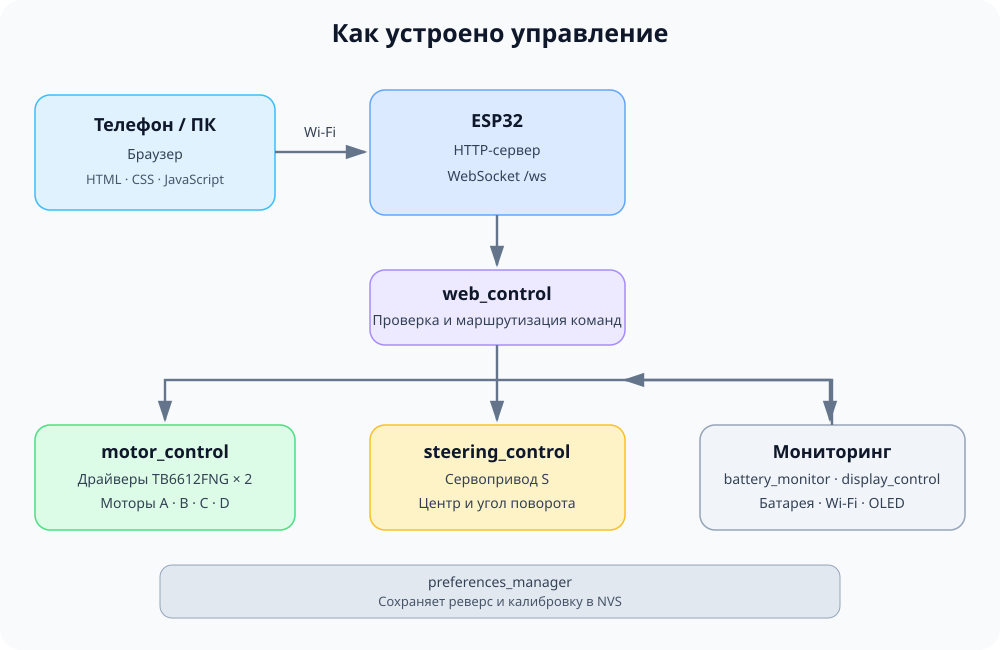
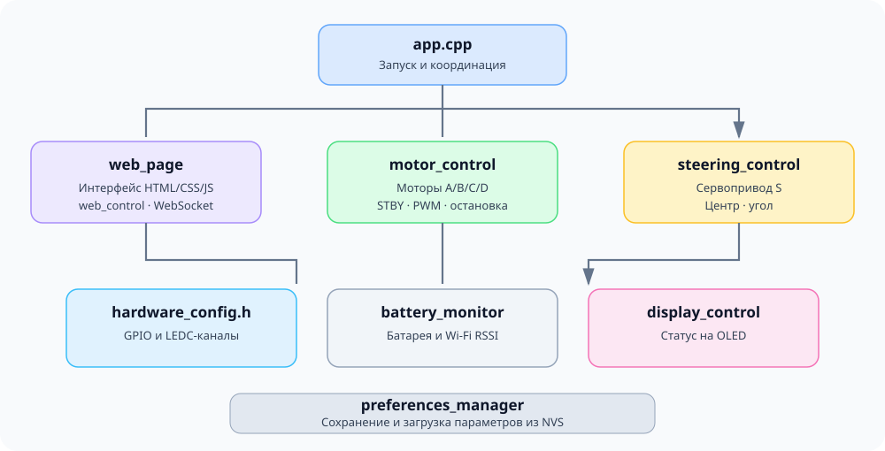
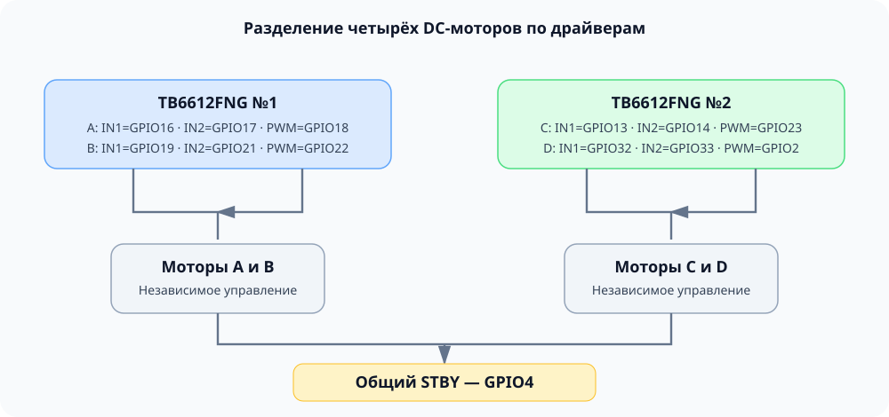
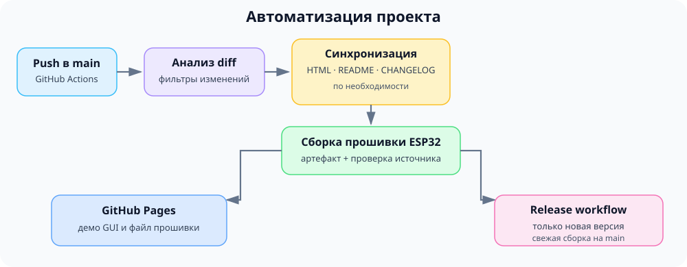

# LEGO Technic ESP32 — логика и техническая документация

> **Версия:** `0.5.26 beta — GUI Update 3.0`  
> **Рабочая ветка:** `feature/four-dc-motors`  
> **Состояние:** программная архитектура и GUI обновлены; аппаратные сценарии требуют проверки на реальной модели.

Документ описывает текущую архитектуру прошивки, распиновку, программные модули, протокол управления, мониторинг и автоматизацию сборки. Если документация расходится с исходным кодом, приоритет имеет актуальный код проекта.

| Быстрые ссылки | |
|---|---|
| Презентация | [README](../README.md) |
| Веб-интерфейс | [Демо GUI](https://dsr987.github.io/lego-technic-esp32/index.html?v=0.5.26%20GUI%20Update%203.0) |
| История версий | [CHANGELOG](../CHANGELOG.md) |
| Главный код прошивки | [`app.cpp`](../lego_technic_esp32/app.cpp) |
| HTML/CSS/JS интерфейса | [`web_page.cpp`](../lego_technic_esp32/web_page.cpp) |
| Распиновка | [`hardware_config.h`](../lego_technic_esp32/hardware_config.h) |

---

## 1. Общая архитектура

ESP32-WROOM-32 создаёт собственную Wi-Fi точку доступа. Пользователь подключается к ней телефоном или компьютером и открывает веб-пульт в браузере. Команды управления передаются по WebSocket, а HTTP отдаёт HTML-страницу и обслуживает OTA-обновление.



### Ключевые принципы

- Управление осуществляется в браузере, отдельное мобильное приложение не требуется.
- Локальная точка доступа ESP32 не требует домашнего роутера.
- Каждый программный модуль отвечает за отдельную область системы.
- GPIO и PWM-каналы собраны в `hardware_config.h`.
- При отсутствии команд управления дольше заданного тайм-аута прошивка вызывает `stopAll()`.
- Heartbeat WebSocket подтверждает активность вкладки, но не повторяет значения слайдеров.
- Калибровка руля и флаги реверса сохраняются в NVS через `Preferences`.
- GitHub Actions выполняет проверки, собирает прошивку и обновляет GitHub Pages и GitHub Releases разными workflow.

## 2. Аппаратная конфигурация

### 2.1. Основные компоненты

| Компонент | Назначение |
|---|---|
| ESP32-WROOM-32 / ESP32 Dev Module | Центральный контроллер |
| 2 × TB6612FNG | Управление четырьмя DC-моторами |
| DC-моторы A, B, C, D | Приводные механизмы модели |
| Сервопривод S | Рулевое управление |
| OLED SSD1306, 128 × 64 | Отображение состояния системы |
| Источник питания и преобразователи | Питание контроллера и приводов |
| Резистивный делитель | Измерение напряжения батареи |

Фактические характеристики моторов, аккумулятора и преобразователей зависят от конкретной сборки. До подключения следует проверить допустимые напряжения, токи, общую землю и требования к питанию компонентов.

### 2.2. Распиновка ESP32

Назначения определены в `lego_technic_esp32/hardware_config.h` и связанных модулях.

| Сигнал | GPIO | Назначение |
|---|---:|---|
| `TB_STBY` | 4 | Общий вход STBY двух TB6612FNG |
| `TB_AIN1` | 16 | Направление мотора A |
| `TB_AIN2` | 17 | Направление мотора A |
| `TB_PWMA` | 18 | PWM мотора A |
| `TB_BIN1` | 19 | Направление мотора B |
| `TB_BIN2` | 21 | Направление мотора B |
| `TB_PWMB` | 22 | PWM мотора B |
| `TB2_AIN1` | 13 | Направление мотора C |
| `TB2_AIN2` | 14 | Направление мотора C |
| `TB2_PWMA` | 23 | PWM мотора C |
| `TB2_BIN1` | 32 | Направление мотора D |
| `TB2_BIN2` | 33 | Направление мотора D |
| `TB2_PWMB` | 1 | PWM мотора D |
| `SERVO_PIN` | 27 | Сигнал сервопривода |
| `OLED_SDA` | 25 | I²C SDA |
| `OLED_SCL` | 26 | I²C SCL |
| `BATT_PIN` | 34 | Аналоговый вход измерения батареи |

### 2.3. Драйверы и PWM

| Мотор | Драйвер | PWM GPIO | LEDC-канал |
|---|---|---:|---:|
| A | TB6612FNG №1 | 18 | 4 |
| B | TB6612FNG №1 | 22 | 5 |
| C | TB6612FNG №2 | 23 | 6 |
| D | TB6612FNG №2 | 1 | 7 |

Параметры PWM DC-моторов: **5 кГц**, разрешение **8 бит**, диапазон заполнения **0–255**. Два драйвера используют общий `STBY`. При запуске прошивка переводит его в LOW и задаёт безопасное начальное состояние входов направления; включение драйверов обрабатывается функцией `updateDriverStandby()`.

> **Аппаратные ограничения**
>
> - GPIO1 обычно используется как UART0 TX. Его применение для PWM мотора D может конфликтовать с последовательным выводом и некоторыми сценариями прошивки.
> - GPIO32 и GPIO33 заняты мотором D, поэтому использовать их для светотехники без изменения распиновки нельзя.
> - Изменение GPIO или LEDC-каналов требует проверки схемы и обновления документации.
> - Необходимо проверить токи драйверов, питание моторов и общую землю на реальном устройстве.

## 3. Структура программных модулей

Основной код находится в `lego_technic_esp32/`.



| Файл | Ответственность |
|---|---|
| `app.cpp` | Инициализация, основной цикл, состояние приложения, HTTP/WebSocket-сервер и координация модулей |
| `lego_technic_esp32.ino` | Точка входа Arduino IDE |
| `hardware_config.h` | Назначения GPIO и LEDC-каналов |
| `motor_control.h/.cpp` | Управление DC-моторами, реверс, общий STBY и остановка |
| `web_page.h/.cpp` | HTML, CSS и JavaScript веб-интерфейса |
| `web_control.h/.cpp` | Обработка входящих WebSocket-команд и событий |
| `steering_control.h/.cpp` | Управление сервоприводом |
| `battery_monitor.h/.cpp` | Напряжение батареи, процент заряда и мониторинг Wi-Fi |
| `display_control.h/.cpp` | Вывод состояния на OLED |
| `preferences_manager.h/.cpp` | Загрузка и сохранение настроек в NVS |

### Правила разделения ответственности

- GPIO и PWM-каналы определяются в `hardware_config.h`.
- Функции управления приводами находятся в `motor_control`.
- Формат входящих команд и события WebSocket обрабатывает `web_control`.
- HTML/CSS/JS интерфейса хранится отдельно от логики прошивки.
- Мониторинг батареи и обновление OLED вынесены из основного цикла.
- Запись настроек выполняет `preferences_manager`.
- `app.cpp` координирует модули, а не содержит всю их реализацию.

При рефакторинге перенос кода должен сохранять поведение. Изменение логики управления следует отделять от простого переноса функций между файлами.

## 4. Режимы управления

Режимы объявлены в `motor_control.h`:

```cpp
enum Mode {
  MODE_TANK = 0,
  MODE_CAR = 1,
  MODE_TEST = 2
};
```

| Режим | Назначение | Основные каналы |
|---|---|---|
| `MODE_TANK` | Независимое управление левой и правой сторонами модели | A — левая сторона, B — правая сторона |
| `MODE_CAR` | Управление машиной с рулём | A — тяга, S — рулевое управление, B — дополнительный привод или имитация ДВС |
| `MODE_TEST` | Проверка отдельных каналов | A/B/C/D — DC-моторы, S — сервопривод |

В танковом режиме A и B управляют сторонами модели независимо. В классическом режиме A управляет тягой, S — рулём, B может использоваться как дополнительный привод. В тестовом режиме интерфейс предназначен для проверки отдельных выходов. Доступные элементы интерфейса зависят от текущей реализации GUI.

### Общие правила

- Значения каналов управления находятся в диапазоне `−100…100`.
- При смене режима прошивка вызывает `stopAll()`.
- Настройки реверса привязаны к физическим каналам, а не к режиму.
- Переключение режима не должно оставлять предыдущие команды движения активными.

## 5. Управление DC-моторами

Базовая функция `setDCBridge()` находится в `motor_control.cpp`. Для каждого мотора прошивка ограничивает вход диапазоном `−100…100`, преобразует абсолютное значение в PWM `0…255`, выставляет направление на входах моста и записывает PWM в соответствующий LEDC-канал.

| Команда | IN1 | IN2 | PWM |
|---|---|---|---|
| Положительное значение | HIGH | LOW | Пропорционально скорости |
| Отрицательное значение | LOW | HIGH | Пропорционально скорости |
| Ноль | LOW | LOW | 0 |

Нулевое значение задаёт LOW на обоих входах направления и PWM 0. Фактическое поведение выбега или торможения зависит от подключения и драйвера.

### 5.1. Реверс

Для каждого мотора предусмотрен независимый флаг: `reverseA`, `reverseB`, `reverseC`, `reverseD`. Реверс меняет знак значения, передаваемого драйверу, не изменяя команду интерфейса.

### 5.2. Имитация двигателя

Имитация ДВС используется в `MODE_CAR`. Когда `engineSimOn == true`, мотор B получает автоматически рассчитанное значение на основе A:

```text
aux = 33 + 67 × abs(motorAVal) / 100
```

Результат округляется до целого значения, а реверс B учитывается при передаче команды драйверу. При выключении имитации мотор B сбрасывается в ноль; при включении прошивка повторно применяет текущее значение A. Ручные команды B во время активной имитации не должны конфликтовать с автоматическим управлением.

В GUI изображение мотора B скрывается во время имитации, а визуальный эффект создаётся свечением корпуса и искрами. Это поведение интерфейса не означает, что физический мотор B обязательно присутствует в конкретной механической сборке.



## 6. Рулевое управление

Сервопривод управляется через `steering_control.cpp`.

| Параметр | Значение |
|---|---|
| Частота | 50 Гц |
| Центр по умолчанию | 1500 мкс |
| Максимальный угол по умолчанию | 45° |
| Команда | `−100…100` |
| Диапазон центра, задаваемый триммером | 1100…1900 мкс |
| Диапазон максимального угла | 5…90° |

Расчёт импульса:

```text
pulse_us = center_us + (value / 100) × max_angle_deg × (1000 / 180)
```

Результат ограничивается программным диапазоном `500–2500 мкс`. Настройки центра и максимального угла сохраняются в NVS. Реальный угол зависит от сервопривода и механики. Для сервопривода непрерывного вращения поведение отличается от позиционного, поэтому программные пределы необходимо проверить на используемой модели.

## 7. HTTP и WebSocket

### 7.1. HTTP-маршруты

HTTP-сервер `AsyncWebServer` работает на порту 80.

| Путь | Назначение |
|---|---|
| `/` | Основная HTML-страница управления |
| `/ws` | WebSocket-соединение |
| `/update` | OTA-интерфейс ElegantOTA |

Эндпоинт `/calib` временно отключён. Калибровка и настройки передаются через WebSocket.

### 7.2. Команды WebSocket

Команды передаются в JSON.

| Назначение | Пример |
|---|---|
| Мотор A | `{"ch":"A","val":75}` |
| Мотор B | `{"ch":"B","val":-30}` |
| Мотор C | `{"ch":"C","val":50}` |
| Мотор D | `{"ch":"D","val":40}` |
| Руль S | `{"ch":"S","val":-25}` |
| Heartbeat вкладки | `{"hb":1}` |
| Переключение режима | `{"mode":1}` |
| Центр руля | `{"trim":15}` |
| Максимальный угол руля | `{"maxdeg":45}` |
| Реверс A/B/C/D | `{"revA":1}` / `{"revB":1}` / `{"revC":1}` / `{"revD":1}` |
| Передний / задний свет | `{"ledF":1}` / `{"ledR":1}` |
| Имитация ДВС | `{"eng":1}` |

Значения `mode`, `trim` и `maxdeg` проверяются и ограничиваются в обработчике. Команды каналов принимаются только для известных каналов и значений в разрешённом диапазоне. Сообщение `{"hb":1}` только обновляет время последней активности и не меняет значения приводов. Оно не повторяет старые значения слайдеров. Состояния света логические: физическое управление светодиодами пока не реализовано.

### 7.3. Статус системы

При подключении клиента сервер отправляет текущий статус, затем обновляет его примерно раз в секунду.

| Поле | Значение |
|---|---|
| `st` | Маркер статуса |
| `v` | Напряжение батареи |
| `p` | Расчётный заряд в процентах |
| `r` | RSSI лучшего подключённого Wi-Fi-клиента |
| `m` | Текущий режим |
| `c` | Количество WebSocket-клиентов |
| `ra`, `rb`, `rc`, `rd` | Состояния реверса моторов |
| `lf`, `lr` | Логические состояния света |
| `es` | Состояние имитации ДВС |
| `tr` | Смещение центра руля относительно 1500 мкс |
| `md` | Максимальный угол рулевого управления |

Пример структуры сообщения (значения приведены для иллюстрации):

```json
{
  "st": 1, "v": 7.85, "p": 75, "r": -45,
  "m": 1, "c": 1,
  "ra": 0, "rb": 0, "rc": 0, "rd": 0,
  "lf": 0, "lr": 0, "es": 0,
  "tr": 0, "md": 45
}
```

## 8. Безопасность управления

### 8.1. Тайм-аут команд

В `app.cpp` задано:

```cpp
const unsigned long CMD_TIMEOUT_MS = 500;
```

Если прошивка не получает сообщений управления или heartbeat дольше заданного времени, основной цикл проверяет состояние приводов и при необходимости вызывает `stopAll()`. Веб-интерфейс отправляет heartbeat каждые 150 мс. Heartbeat поддерживает контроль активности вкладки, но не повторяет последнее значение слайдера. Поэтому после срабатывания тайм-аута ранее заданная ненулевая команда не должна сама собой включить мотор повторно: для нового движения требуется новое событие управления от интерфейса. При переподключении WebSocket GUI сбрасывает команды и имитацию двигателя, а затем отправляет нулевые значения каналов.

### 8.2. `stopAll()`

Функция в `motor_control.cpp`:

- выключает имитацию двигателя;
- обнуляет значения A, B, C и D;
- устанавливает нулевые команды на все четыре драйверных канала;
- возвращает рулевое управление к центральному значению;
- обновляет состояние STBY.

### 8.3. Начальная инициализация

При запуске прошивка устанавливает STBY в LOW, переводит входы направления моторов в безопасное состояние, настраивает PWM, инициализирует сервопривод и OLED, загружает настройки, запускает Wi-Fi точку доступа, настраивает HTTP/WebSocket/OTA и вызывает `stopAll()`.

### 8.4. Ограничения защиты

Тайм-аут и `stopAll()` — программные механизмы защиты, а не замена аппаратной проверке. Требуется проверить потерю Wi-Fi, закрытие браузера, перезапуск контроллера и обрыв питания.

## 9. Мониторинг батареи, Wi-Fi и OLED

### 9.1. Измерение напряжения

Реализация находится в `battery_monitor.cpp`.

- GPIO34 используется как аналоговый вход.
- Для одного измерения усредняются восемь показаний АЦП.
- Коэффициент делителя — `BATT_DIVIDER_FACTOR = 0.2680`.
- Напряжение пересчитывается в вольты.

```text
V_adc  = (среднее значение ADC / 4095) × 3.3
V_batt = V_adc / 0.2680
```

Коэффициент должен соответствовать фактическому делителю и калибровке измерений. Показания следует сверить с мультиметром.

### 9.2. Расчёт уровня заряда

Опорные точки для текущей реализации:

| Напряжение | Расчётный заряд |
|---:|---:|
| 6.0 В | 0% |
| 6.8 В | 10% |
| 7.0 В | 25% |
| 7.4 В | 50% |
| 7.8 В | 75% |
| 8.2 В | 100% |

Между точками применяется линейная интерполяция. Процент обновляется после нахождения модели в состоянии покоя в течение 400 мс; напряжение измеряется при каждом обновлении мониторинга. Порог низкого заряда — ниже 6.0 В. Предупреждение формируется после нескольких последовательных низких измерений; отключённая батарея обрабатывается отдельно.

Пороги являются настройками текущей реализации и требуют проверки с фактическим аккумулятором.

### 9.3. Wi-Fi и OLED

Мониторинг получает RSSI подключённых к точке доступа клиентов и использует лучшее доступное значение. Если клиентов нет или чтение состояния не удалось, возвращается 0.

`display_control.cpp` отображает текущий режим, процент заряда, напряжение батареи, количество WebSocket-клиентов и предупреждение `LOW BATTERY` при подтверждённом низком заряде. OLED SSD1306 использует адрес I²C `0x3C`.

## 10. Сохранение настроек

Настройки сохраняются в NVS через `Preferences`; пространство имён — `cfg`.

| Ключ | Тип | Назначение |
|---|---|---|
| `revA` | `uint8_t` | Реверс мотора A |
| `revB` | `uint8_t` | Реверс мотора B |
| `revC` | `uint8_t` | Реверс мотора C |
| `revD` | `uint8_t` | Реверс мотора D |
| `ledF` | `uint8_t` | Логическое состояние переднего света |
| `ledR` | `uint8_t` | Логическое состояние заднего света |
| `steer_c` | `int` | Центр сервопривода в микросекундах |
| `steer_a` | `int` | Максимальный угол рулевого управления |

Режим работы и состояние имитации двигателя в текущем `preferences_manager.cpp` не сохраняются. Не переименовывай ключи NVS без миграции или осознанного сброса настроек.

## 11. Сборка, зависимости и OTA

### Основные зависимости

- Arduino ESP32 Core `2.0.9`;
- ESPAsyncWebServer `3.1.0`;
- AsyncTCP `1.1.4`;
- ArduinoJson;
- Adafruit SSD1306;
- Adafruit GFX Library;
- Adafruit BusIO;
- ESP32Servo;
- ElegantOTA.

Некоторые библиотеки устанавливаются без жёстко заданной версии, поэтому после обновления зависимостей требуется проверять совместимость. Проект использует классический API LEDC; обновление Arduino ESP32 Core также требует отдельной проверки.

### Ручная сборка в Arduino IDE

1. Установить ESP32 Arduino Core `2.0.9`.
2. Установить библиотеки из списка выше.
3. Открыть `lego_technic_esp32/lego_technic_esp32.ino`.
4. Выбрать плату **ESP32 Dev Module**.
5. Выполнить компиляцию и прошивку.

### OTA

В `app.cpp` ElegantOTA инициализируется с учётными данными по умолчанию. Перед использованием OTA в доступной другим людям сети необходимо заменить стандартные учётные данные и проверить настройки доступа.

## 12. GitHub Actions и публикация



### `ci-build-deploy.yml`

Основной workflow выполняет операции в зависимости от события запуска и изменённых файлов:

1. Определяет, затронуты ли исходники прошивки, HTML и метаданные.
2. При необходимости извлекает HTML из `web_page.cpp` (или из `app.cpp`, если там находится `PAGE_HTML`).
3. Обновляет `CHANGELOG.md` по маркерам в начале `app.cpp` и синхронизирует версию и ссылку на демо в `README.md`.
4. При изменении исходников прошивки компилирует приложение ESP32. При необходимости также собирает bootstrap для первоначальной прошивки по USB.
5. Подготавливает артефакты сборки; они предназначены для проверки и скачивания из GitHub Actions и хранятся ограниченное время.
6. На ветке `main` публикует GitHub Pages с демо GUI и файлом прошивки `downloads/build_firmware_for_esp32.bin`. На `feature/four-dc-motors` развертывание Pages пропускается.
7. Если исходники bootstrap изменились или пересобраны вместе с приложением, обновляет файл `firmware/bootstrap/prebuilt/esp32_ota_bootstrap.bin`.

При ручном запуске workflow выполняет полную сборку. При обычном push некоторые шаги пропускаются, если изменившиеся файлы их не требуют.

### Статический аудит проекта

Скрипт `tools/project_auditor.py` запускается в составе workflow `pull-request-validation.yml` как задача `Project Static Audit` при проверке Pull Request в `main`.

Аудит проверяет структуру исходников и наличие критически важных защитных механизмов, включая обработку heartbeat, переподключение WebSocket и остановку моторов при отсутствии управляющих команд.

Отдельный workflow `project_auditor.yml` удалён, чтобы избежать дублирования запусков GitHub Actions. Сам скрипт и все его проверки сохранены.

### `pull-request-validation.yml`

Workflow запускается при создании или обновлении Pull Request в "main", если изменены файлы, подпадающие под настроенные фильтры. Он выполняет статический аудит проекта и компилирует прошивку ESP32 перед слиянием. Он не публикует GitHub Pages и не создаёт релизы.

### `publish-release.yml`

Публикует GitHub Release только после успешного запуска `Build, Extract and Deploy` в `main`, если в этом запуске действительно была собрана новая прошивка и её исходники всё ещё соответствуют актуальному состоянию ветки. К релизу прикладываются `lego_technic_esp32.ino.bin` и его SHA-256. Этот BIN предназначен для OTA-обновления уже настроенного контроллера; он не является полным образом для первичной прошивки пустой ESP32.

Успешная облачная компиляция подтверждает сборку кода, но не гарантирует корректную работу подключённой аппаратуры.

## 13. Ограничения текущей версии

- Работа четырёх DC-моторов требует проверки на реальной модели.
- Работу сервопривода и его диапазоны необходимо проверить аппаратно.
- Физическое управление светом не реализовано: `applyLeds()` пока пустая.
- GPIO32 и GPIO33 заняты мотором D.
- GPIO1 используется как PWM мотора D и может конфликтовать с UART0 TX.
- Измерение батареи требует калибровки по фактическому делителю и аккумулятору.
- OLED и мониторинг Wi-Fi требуют проверки на устройстве.
- Эндпоинт `/calib` отключён.
- Поведение при потере связи и восстановлении соединения должно быть проверено экспериментально.
- Публикация прошивки не означает завершённую аппаратную валидацию.

## 14. План аппаратных испытаний

Перед выпуском необходимо проверить каждый пункт:

- [ ] Моторы A, B, C и D запускаются независимо.
- [ ] Направление и скорость каждого мотора корректны.
- [ ] Реверс каждого мотора сохраняется после перезапуска.
- [ ] Танковый, классический и тестовый режимы работают ожидаемо.
- [ ] Имитация ДВС не конфликтует с ручным управлением B.
- [ ] Сервопривод работает в допустимом диапазоне и центрируется корректно.
- [ ] При смене режима выполняется остановка приводов.
- [ ] При прекращении heartbeat/команд срабатывает тайм-аут.
- [ ] После переподключения управление восстанавливается предсказуемо, без самопроизвольного старта старых команд.
- [ ] Настройки сохраняются и загружаются корректно.
- [ ] Напряжение батареи совпадает с контрольным измерением в допустимых пределах.
- [ ] Предупреждение низкого заряда срабатывает корректно.
- [ ] OLED отображает актуальное состояние.
- [ ] OTA обновляет прошивку без нарушения работы системы.
- [ ] Ссылка GitHub Pages отдаёт актуальный `index.html` и файл OTA-прошивки.
- [ ] GitHub Release содержит бинарник текущей версии и соответствующую контрольную сумму.

## 15. Правила дальнейшего развития

- Не менять GPIO без пересмотра схемы и проверки ограничений ESP32.
- Не менять PWM-каналы без проверки совместимости с используемыми библиотеками.
- Не объединять модули обратно в `app.cpp` без архитектурной необходимости.
- Не дублировать обработку одних и тех же команд в нескольких модулях.
- Не удалять ключи NVS без плана миграции.
- Не считать функцию реализованной только потому, что для неё есть кнопка в интерфейсе.
- После изменений в логике управления выполнять сборку и, если затронуто поведение, аппаратную проверку.
- До проверки реальной модели можно подготовить pull request и пройти CI, но не выпускать прошивку как аппаратно проверенную и не завершать слияние в стабильную `main` до проверки управления на устройстве.

> **Главный принцип:** модульная архитектура должна облегчать развитие и обслуживание прошивки, а документация — отражать реализованное поведение, отдельно обозначая незавершённые функции и непроверенные аппаратные сценарии.
